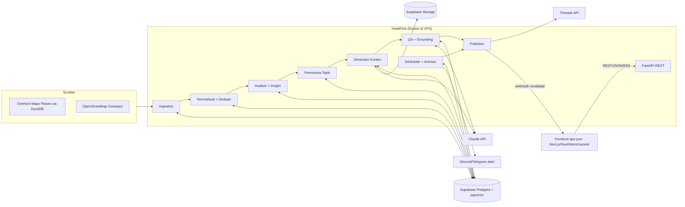

# ARCHITECTURE — HotelPilot (nama kerja)

> Versi 0.3 · 18 Nov 2026 · Pasangan dari `PRD.md`. ID `FR-xx`/`NFR-xx` merujuk ke PRD.
> **Lingkup assessment v0.3**: tabel "Keputusan v0.2–v0.3" di `TASKS.md` menimpa dokumen ini bila bertentangan. Ringkasnya: tanpa kolom `embedding` (`pg_trgm`), posting TEXT saja, sumber Overture + OSM, tanpa rating.

---

## 1. Prinsip Desain

1. **Headless, API-first**: agen tidak peduli framework frontend. Semua keluaran lewat REST, feed, dan webhook.
2. **Pipeline berbasis tahap**: tiap tahap punya input/output tersimpan di DB, bisa diulang dan di-debug sendiri.
3. **Fakta dulu, prosa kemudian**: LLM hanya boleh menulis dari paket `facts` yang disusun kode, bukan dari ingatannya.
4. **Plugin di tepi**: sumber data, kanal sosial, dan penyedia gambar berada di balik antarmuka sehingga bisa ditambah tanpa ubah inti.
5. **Idempotent dan dapat dipulihkan**: semua job aman diulang.
6. **Satu database**: Postgres (Supabase) untuk data, antrean, dan vektor. Tanpa Redis di MVP.

## 2. Gambaran Sistem



## 3. Komponen

| Komponen | Tanggung jawab | FR |
|----------|----------------|----|
| **Ingestion** | Menjalankan provider per wilayah, menyimpan snapshot mentah | FR-01..07 |
| **Normalizer** | Memetakan ke skema hotel seragam, dedupe, penggabungan lintas sumber | FR-03, 04 |
| **Analyzer** | Skor kelengkapan atribut, top-N, perbandingan area, perubahan atribut antar-sapuan | FR-10, 11, 13 |
| **Topic Planner** | Memilih topik berikutnya, menghindari tumpang-tindih | FR-12 |
| **Content Generator** | Artikel ID+EN, FAQ, SEO, prompt gambar, snippet sosial | FR-20..24 |
| **QA Gate** | Grounding, duplikasi, kebijakan, panjang, bahasa | FR-30..34 |
| **Publisher (blog)** | Menyimpan status `published`, memicu webhook | FR-40, 41 |
| **Scheduler** | Slot 2 jam, buffer, pemilihan konten | FR-42, 46, 47 |
| **Queue Worker** | Mengeksekusi job dengan retry dan dead-letter | FR-43 |
| **Channel: Threads** | Publish dua langkah, kuota, refresh token | FR-44, 45 |
| **API (FastAPI)** | Baca konten publik, admin, health | FR-40, 50 |
| **Notifier** | Alert dan laporan harian | FR-51, 52 |

## 4. Teknologi

| Lapisan | Pilihan | Alasan |
|---------|---------|--------|
| Bahasa/Framework | Python 3.12, FastAPI, Pydantic v2 | Ekosistem scraping dan AI terkuat, validasi ketat |
| HTTP klien | `httpx` (async) + `tenacity` untuk retry | Standar, mudah di-mock |
| DB akses | SQLAlchemy 2 + `asyncpg`, migrasi via Supabase CLI (SQL) | Skema SQL jelas, RLS tertulis |
| Antrean | Tabel `jobs` di Postgres, `FOR UPDATE SKIP LOCKED` | Tanpa infrastruktur tambahan |
| Penjadwal | APScheduler di proses `worker` (cron WITA) | Sederhana, satu proses |
| LLM | Claude API: model kuat untuk penulisan, model kecil untuk klasifikasi/QA | Kualitas tulisan dan biaya berjenjang |
| Output terstruktur | JSON schema + validasi Pydantic, retry bila gagal parse | Hindari output rusak |
| Embedding | pgvector di Supabase | Deteksi duplikasi tanpa layanan baru |
| Crawl | Firecrawl atau Playwright, hanya domain di allowlist | Kontrol kepatuhan |
| Penyimpanan gambar | Supabase Storage (bucket publik untuk aset terbit) | URL publik dibutuhkan Threads untuk gambar |
| Observabilitas | `structlog` JSON, Sentry opsional | Debug cepat |
| Deploy | Docker Compose di VPS (`api`, `worker`), Supabase terkelola | Sesuai infrastruktur yang sudah ada |
| CI | GitHub Actions: ruff, mypy, pytest | Gerbang kualitas |

## 5. Alur Pipeline

```
[1] ingest      → raw_snapshots
[2] normalize   → hotels, hotel_snapshots
[3] analyze     → insights (+ insight_refs ke hotel/field)
[4] plan        → topics (status: planned)
[5] generate    → articles (draft) + image_assets + social_posts (draft)
[6] qa          → lulus: ready | gagal: rejected (alasan tersimpan) | review: needs_review
[7] schedule    → slot Threads diisi dari social_posts berstatus ready
[8] publish     → blog published + webhook; Threads published
[9] measure     → post_metrics (Fase 6)
```

### 5.1 Strategi Generasi (anti-halusinasi)

1. **Fact Pack**: kode menyusun JSON berisi hotel terpilih, field, nilai, sumber, tanggal ambil. LLM hanya melihat ini.
2. **Outline lalu draft**: dua panggilan (outline terstruktur, lalu isi per bagian) agar kontrol lebih baik dan biaya terukur.
3. **Penanda klaim**: tiap kalimat bernilai fakta membawa `claim_id` yang menunjuk ke `fact_id` pada tabel `claim_map`.
4. **Grounding check**: kode (angka, nama, bintang) dan LLM-hakim (kalimat naratif) memverifikasi. Klaim tanpa pemetaan membuat artikel ditolak.
5. **Adaptasi bilingual**: ID dan EN dihasilkan dari outline yang sama, tiap bahasa ditulis alami, bukan terjemahan literal.
6. **Prompt gambar**: dibuat dari isi artikel, tanpa nama merek/orang nyata, memuat gaya, rasio, dan alt text.

### 5.2 Mesin Status

```
topic:        planned → generating → generated | failed
article:      draft → ready | needs_review | rejected → published → archived
social_post:  draft → ready → queued → publishing → published | failed → dead
job:          pending → running → succeeded | failed → (retry) → dead
```

## 6. Model Data (Supabase Postgres)

Semua tabel memakai `id uuid`, `created_at`, `updated_at`. RLS aktif; layanan agen memakai service role, frontend publik hanya membaca lewat API.

| Tabel | Kolom penting |
|-------|---------------|
| `regions` | `slug`, `name`, `bbox/polygon`, `active` |
| `sources` | `key` (google_places, osm, …), `config`, `tos_notes`, `cache_ttl_days`, `active` |
| `raw_snapshots` | `source_id`, `region_id`, `external_id`, `payload jsonb`, `fetched_at`, `expires_at` |
| `hotels` | `canonical_name`, `slug`, `lat`, `lng`, `address`, `region_id`, `star`, `category`, `merged_from jsonb` |
| `hotel_snapshots` | `hotel_id`, `source_id`, `stars`, `amenities text[]`, `website`, `phone`, `email`, `confidence`, `operating_status`, `attr_hash`, `taken_at` |
| `insights` | `type`, `scope`, `params jsonb`, `result jsonb`, `computed_at` |
| `insight_refs` | `insight_id`, `hotel_id`, `field`, `value`, `snapshot_id` |
| `topics` | `kind`, `region_id`, `params`, `status`, `embedding vector` |
| `articles` | `topic_id`, `status`, `slug`, `published_at`, `data_as_of`, `ai_disclosure` |
| `article_i18n` | `article_id`, `lang` (id/en), `title`, `summary`, `body_md`, `faq jsonb`, `meta_title`, `meta_desc`, `embedding vector` |
| `claim_map` | `article_id`, `lang`, `claim_id`, `sentence`, `fact_ref` |
| `image_assets` | `article_id`, `role` (hero/support), `prompt`, `negative_prompt`, `ratio`, `alt_id`, `alt_en`, `url`, `status` |
| `social_accounts` | `channel`, `external_user_id`, `token_enc`, `token_expires_at`, `active` |
| `social_posts` | `article_id`, `channel`, `angle`, `text`, `topic_tag`, `image_asset_id`, `link_url`, `status`, `scheduled_for`, `external_post_id` |
| `schedule_slots` | `channel`, `slot_at`, `social_post_id`, `status` |
| `jobs` | `type`, `payload`, `run_at`, `attempts`, `max_attempts`, `locked_at`, `status`, `error`, `idempotency_key` (unique) |
| `run_logs` | `run_id`, `stage`, `status`, `llm_tokens_in/out`, `cost_usd`, `duration_ms`, `error` |
| `settings` | `key`, `value jsonb` (kill_switch, review_mode, style_guide, budget_daily_usd) |

Indeks kunci: `jobs(status, run_at)`, `schedule_slots(channel, slot_at)` unik, `social_posts(status, scheduled_for)`, `hotels(region_id, slug)` unik, ivfflat/hnsw pada kolom `embedding`.

## 7. Kontrak Plugin

```python
# ingestion/providers/base.py
class HotelProvider(Protocol):
    key: str

    async def fetch(self, region: Region, cursor: str | None) -> FetchPage: ...
    def normalize(self, raw: dict) -> NormalizedHotel: ...

    cache_ttl_days: int
    respects_robots: bool


# publishing/channels/base.py
class SocialChannel(Protocol):
    key: str

    async def publish(self, post: SocialPost) -> PublishResult: ...
    async def quota(self) -> Quota: ...
    async def refresh_credentials(self) -> None: ...


# content/images/base.py   (opsional, Fase lanjutan)
class ImageProvider(Protocol):
    async def generate(self, asset: ImageAsset) -> BinaryAsset: ...
```

## 8. Penjadwalan dan Publikasi (inti persyaratan 2 jam)

**Slot**: cron `0 */2 * * *` zona `Asia/Makassar` → 12 slot per hari (00, 02, … 22). Jam aktif dapat dibatasi lewat `settings`.

**Siklus tiap slot**
1. `tick` (tiap menit) memeriksa slot yang jatuh tempo dan `kill_switch`.
2. Pilih `social_posts` berstatus `ready` dengan aturan variasi (bukan sudut yang sama dengan 3 posting terakhir, bukan artikel yang sama berturut-turut).
3. Buat `job` publish dengan `idempotency_key = channel:slot_at`.
4. Worker mengunci job (`SKIP LOCKED`), menjalankan alur Threads:
   - `POST /{user-id}/threads` (TEXT atau IMAGE, `text` ≤ 500 karakter, `image_url` publik, `topic_tag`)
   - Cek status container hingga `FINISHED`
   - `POST /{user-id}/threads_publish`
   - Simpan `external_post_id`, ubah status `published`
5. Gagal: retry 1 mnt → 5 mnt → 15 mnt, lalu `dead` dan alert.
6. Pastikan tidak ada dobel: sebelum publish ulang, periksa `external_post_id` dan idempotency key.

**Batasan Threads yang dirancang masuk ke kode**
- Maksimal 250 posting API per 24 jam per profil (kita memakai 12, aman). Tetap dipantau lewat `threads_publishing_limit`.
- Teks maksimal 500 karakter, emoji dihitung dalam byte UTF-8, jadi validasi memakai hitung byte-aware dengan margin.
- Token jangka panjang berlaku 60 hari: job harian me-refresh bila sisa < 15 hari, alert bila gagal.
- Gambar harus berupa URL publik (JPEG/PNG): dilayani dari Supabase Storage.

**Buffer dan fallback**
- Job `replenish` berjalan tiap 6 jam: jika `ready` < 24, picu pipeline [4]–[6].
- Jika slot tiba dan tidak ada konten `ready`, pakai pool *evergreen*; jika kosong, lewati slot dan kirim alert.

**Blog**
- Artikel berstatus `ready` diterbitkan terjadwal (mis. 1–3 artikel/hari, configurable). Saat terbit: set `published_at`, perbarui feed/sitemap, kirim webhook.
- Snippet Threads berisi sudut berbeda dari artikel yang sama dan tautan balik ke blog.

## 9. Permukaan API

Dasar: `/v1`, OpenAPI di `/docs`, klien TypeScript dihasilkan dari `openapi.json`.

**Publik (baca, API key opsional)**
| Endpoint | Fungsi |
|----------|--------|
| `GET /v1/articles?lang=id&region=&tag=&page=` | Daftar artikel terbit |
| `GET /v1/articles/{slug}?lang=` | Detail artikel + gambar + FAQ + data_as_of |
| `GET /v1/hotels/{slug}` | Profil hotel ternormalisasi |
| `GET /v1/feed.json`, `GET /rss.xml`, `GET /sitemap.xml` | Feed |
| `GET /healthz` | Health |

**Admin (JWT Supabase Auth, peran `operator`)**
| Endpoint | Fungsi |
|----------|--------|
| `GET /v1/admin/queue` | Slot, job, status |
| `POST /v1/admin/articles/{id}/approve` · `/reject` | Review manual |
| `POST /v1/admin/pipeline/run` | Picu pipeline manual (region, topik) |
| `POST /v1/admin/publish/{social_post_id}` | Publish paksa |
| `POST /v1/admin/kill-switch` | Hentikan/lanjutkan semua publikasi |
| `GET /v1/admin/reports/daily` | Ringkasan harian |

**Webhook keluar ke frontend**
```
POST {FRONTEND_REVALIDATE_URL}
Header: X-Signature: HMAC-SHA256(body, WEBHOOK_SECRET)
Body: { "event": "article.published", "slug": "...", "lang": ["id","en"], "published_at": "..." }
```
Panduan integrasi: Next.js (`revalidateTag`), Astro/Nuxt (rebuild hook), Laravel (cache clear).

## 10. Keamanan dan Kepatuhan

- Rahasia lewat env/secret manager; token sosial terenkripsi (AES-GCM, kunci di env) di `social_accounts`.
- RLS aktif; service role hanya di worker/API.
- Webhook ditandatangani HMAC, API admin ber-JWT, rate limit pada endpoint publik.
- Kepatuhan data: tabel `sources` mencatat `tos_notes` dan `cache_ttl_days`; job `expire_cache` menghapus/menyegarkan data yang melewati batas. Crawler hanya berjalan untuk domain di allowlist dengan pengecekan robots.txt, jeda per domain, dan User-Agent jujur.
- Lisensi data: footer blog dan field `attribution` API memuat "© OpenStreetMap contributors" (ODbL) dan "Overture Maps Foundation" (CDLA-Permissive-2.0/Apache-2.0). Data per sumber disimpan terpisah; endpoint data hotel gabungan berlabel ODbL. Overpass: < 100 query/hari, jeda antar request, tanpa paralel, cache, User-Agent jujur.
- Konten: tidak menyalin ulasan verbatim, memuat label bantuan AI dan `data_as_of`, klaim harga hanya bila bersumber.
- Kill-switch dan mode review manual tersedia sejak MVP.

## 11. Observabilitas dan Biaya

- Setiap run punya `run_id`; `run_logs` mencatat token, biaya, durasi per tahap.
- Anggaran harian LLM di `settings.budget_daily_usd`: bila terlampaui, pipeline generasi berhenti, publikasi dari buffer tetap jalan.
- Alert ke Discord/Telegram: job dead, buffer < 12, token < 15 hari, anggaran > 80%, QA gagal beruntun.

## 12. Struktur Repo

```
hotelpilot/
├─ CLAUDE.md                  # aturan repo untuk vibe coding (konteks tetap)
├─ docs/  PRD.md ARCHITECTURE.md TASKS.md
├─ specs/                     # satu spec per fitur (sumber kebenaran)
│  ├─ 001-schema.md  002-ingestion.md  003-normalize-dedupe.md
│  ├─ 004-analysis.md  005-topic-planner.md  006-content-generator.md
│  ├─ 007-qa-grounding.md  008-blog-api.md  009-scheduler-queue.md
│  └─ 010-threads-channel.md  011-ops-alerts.md
├─ supabase/migrations/       # SQL + RLS
├─ src/hotelpilot/
│  ├─ core/        config.py db.py logging.py security.py llm.py
│  ├─ ingestion/   providers/{base,overture,osm}.py runner.py
│  ├─ normalize/   mapper.py dedupe.py
│  ├─ analysis/    scoring.py insights.py planner.py
│  ├─ content/     prompts/ factpack.py writer.py i18n.py images.py social.py qa.py
│  ├─ publishing/  scheduler.py queue.py blog.py webhook.py channels/{base,threads}.py
│  ├─ api/         main.py routers/{public,admin}.py deps.py
│  ├─ workers/     worker.py jobs.py
│  └─ notify/      discord.py telegram.py
├─ tests/  unit/ integration/ fixtures/ contract/
├─ docker/ Dockerfile docker-compose.yml
├─ .github/workflows/ci.yml
└─ pyproject.toml
```

## 13. Strategi Pengujian

| Level | Isi |
|-------|-----|
| Unit | normalisasi, dedupe, skor, pemotong teks 500 byte, pemilih slot |
| Kontrak | tiap provider dan channel diuji terhadap fixture respons nyata (VCR/respx) |
| Integrasi | pipeline end-to-end dengan Supabase lokal dan LLM di-mock |
| Evaluasi konten | set uji golden: Fact Pack → artikel, lalu ukur grounding dan duplikasi |
| Sandbox publikasi | akun Threads uji sebelum akun produksi |
| Gerbang CI | ruff, mypy, pytest, cakupan inti ≥ 80% |

## 14. Deployment

```
VPS (Docker Compose)
 ├─ api     (uvicorn, port internal, di balik Cloudflare Tunnel/reverse proxy)
 └─ worker  (APScheduler + queue consumer, 1 replika)

Supabase (terkelola): Postgres + pgvector, Storage, Auth
Eksternal: Claude API, Overture (S3 publik), Overpass API, Threads API
```
- Satu replika `worker` di MVP untuk menghindari ganda penjadwalan; kunci advisory Postgres sebagai pengaman bila diskalakan.
- Konfigurasi lingkungan: `dev` (Supabase lokal), `staging` (akun Threads uji), `prod`.

## 15. Keputusan Arsitektur (ADR ringkas)

| # | Keputusan | Alternatif | Alasan |
|---|-----------|-----------|--------|
| 1 | Antrean di Postgres | Redis/Celery | Mengurangi komponen, volume rendah (12 posting/hari) |
| 2 | APScheduler di worker | pg_cron, Vercel Cron | Satu tempat logika jadwal, mudah dites |
| 3 | Fact Pack + claim_map | Prompt bebas | Menekan halusinasi, mudah diaudit |
| 4 | Prompt gambar saja di MVP | Generasi otomatis | Kualitas dan biaya gambar perlu diuji, adapter siap |
| 5 | Headless REST + webhook | CMS bawaan | Bisa dipasang ke framework apa pun |
| 6 | API resmi diprioritaskan | Scraping OTA | Risiko ToS dan stabilitas |
| 7 | Overture + OSM (data terbuka) | Google Places | Biaya SKU Enterprise dan larangan menyimpan nama/rating (v0.3) |
| 8 | `pg_trgm` + rotasi area | Embedding (pgvector) | Claude tidak menyediakan embedding; tanpa penyedia baru (v0.2) |
